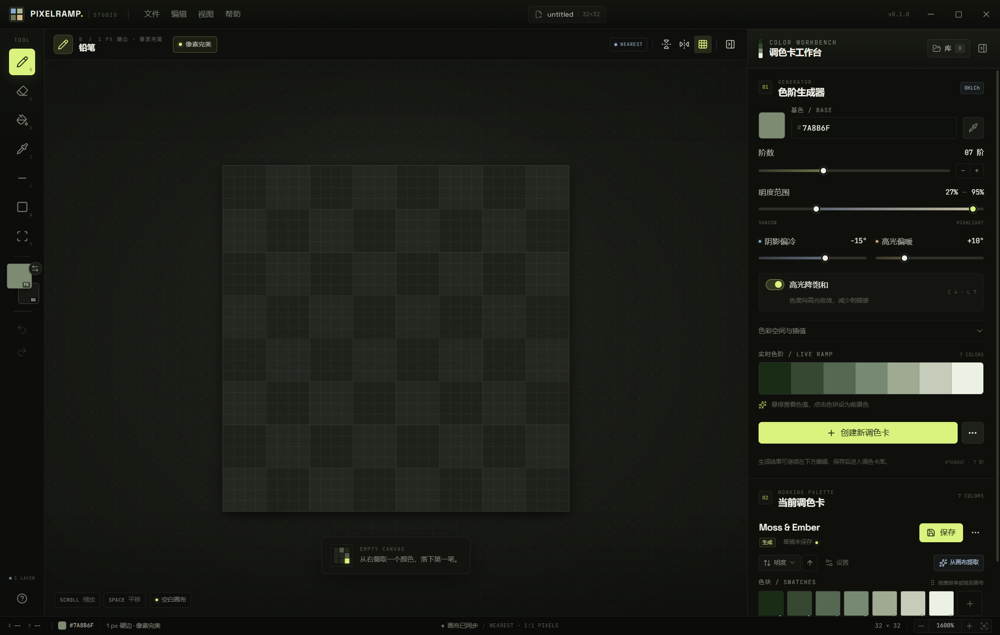
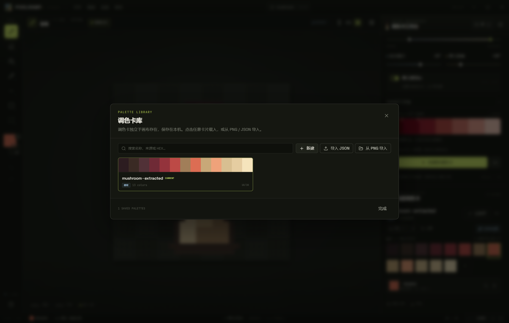

# PixelRamp Studio

<p align="center">
  <strong>A palette-first pixel texture workbench for Minecraft artists.</strong><br />
  为 Minecraft 像素纹理创作者打造的调色卡优先工作台。
</p>

<p align="center">
  
</p>
<p align="center"><sub>Workbench / 工作台</sub></p>

<p align="center">
  
</p>
<p align="center"><sub>Palette library / 调色卡库</sub></p>

<p align="center">
  
  
  
  
</p>

<p align="center">
  <a href="#english">English</a> · <a href="#chinese">中文</a> · <a href="https://github.com/DimoIer/Pixelramp/releases">Releases</a>
</p>

---

<a id="english"></a>
## English

**PixelRamp Studio** is a desktop pixel-art workstation built around palettes. Build a readable ramp first, then paint the texture: stop hunting for shadow and highlight colors one swatch at a time.

> **Status:** Tauri v2 + Rust desktop build with a React/TypeScript renderer. Portable ZIP and NSIS installer builds are distributed through [Releases](https://github.com/DimoIer/Pixelramp/releases); generated packages are intentionally not committed to this repository.

### Highlights

- **Pixel canvas** — 8 / 16 / 32 / 64 presets and custom square canvases from 1–256 px. Pencil and eraser with 1–32 px square brushes, pixel-perfect mode, bucket (tolerance 0, contiguous toggle), eyedropper, line, rectangle, and rectangular selections with move / copy / cut / paste / delete. Left-drag paints; right-drag or Space-drag pans.
- **Image adjustments** — brightness/contrast, hue/saturation, per-layer alpha opacity, invert colors, and a five-point RGB master curve. Each dialog previews the current layer; adjustments are undoable.
- **Texture scaling** — percentage-based nearest-neighbor scaling of all layers (10–400%, clamped to 1–256 px), preserving the layer stack and visibility.
- **Tabs and layers** — multiple documents open as tabs with independent history, selection, zoom and pan. Layer stack with add, duplicate, delete, reorder, merge-down, visibility, opacity and inline rename. Projects preserve the layer stack.
- **Current build/design** — 3 UI accent themes (Moss / Cobalt / Ember) plus a light canvas toggle; Chinese/English interface switch in the appearance menu; resizable canvas with nine-point anchoring and non-scaling crop/pad.
- **Panel workspace** — View menu manages toolbar/palette visibility and floating. Drag the toolbar grip or a palette section header directly: a full-size ghost follows the cursor and the detached floating panel keeps exactly the same size as that preview. Entering a dock zone reserves the real layout space with a same-size dashed placeholder and accent highlight, so the canvas/other sections move aside instead of being covered. Release over the left/right edge or the palette to dock. Drag the generator and working-palette headers over each other to swap their order. Docked borders resize the tool rail and palette columns; the layers panel is draggable/resizable. Toolbar controls live in the floating bar and can switch vertical/horizontal layout.
- **Drawing experience** — integer zoom levels, cursor-anchored wheel zoom, space / middle-button / right-button panning, X/Y mirror symmetry, toggleable pixel grid, 80-step stroke-based undo/redo, transparent checkerboard, and hard-edged nearest-neighbor rendering.
- **OKLCh ramp generator** — 3–15 steps, editable base color, lightness range, cool-shadow / warm-highlight hue shifts, chroma taper, linear or eased interpolation, OKLCh/HSL modes, live preview, gamut warnings, and too-many-steps warnings.
- **Color extraction** — exact unique-color extraction with frequency counts, alpha-0 ignored, optional semi-transparent pixels, optional OKLab ΔE merging, sorting by lightness / hue / chroma / frequency or manual drag order; works on the whole canvas or a selection. Runs in a Web Worker.
- **Palette library** — named palettes are first-class, persisted local objects. Edit any swatch, add/remove/reorder colors, save, duplicate, delete, import/export JSON, export a PNG palette strip with optional hex labels, and drag swatches directly onto the canvas.
- **Files** — open PNG / JPEG / BMP / GIF (first frame), crop or nearest-neighbor scale for non-square or oversized images, export integer-scaled PNG, save/open `.pxramp` projects (ZIP with manifest, raw RGBA pixels, per-layer pixel data and a palette snapshot), and reopen recent files.
- **Desktop details** — custom frameless titlebar, unsaved-changes close guard for all tabs, local persistence, theme/language preferences, and a custom application icon.

### Run from source

Requirements: Windows 10/11, WebView2 (included with Windows 11), Node.js 20.19+ or 22.12+, Rust stable-msvc, and Visual Studio C++ Build Tools. The Tauri CLI, `@tauri-apps/api`, and the dialog plugin are already listed in `package.json`.

```powershell
npm install
npm run dev:tauri
```

`npm run dev:tauri` starts the Vite frontend and the Rust/WebView2 desktop window. Browser-only UI preview (file operations degrade to downloads / file input):

```powershell
npm run dev:web
# http://localhost:5173
```

Test and build:

```powershell
npm test
npm run build:tauri
npm run package:tauri
npm run bundle:tauri
```

`npm run build:tauri` builds the frontend and produces an executable at `src-tauri/target/release/pixelramp.exe`. `npm run package:tauri` copies that executable into `release/PixelRamp-0.1.0-tauri/` and creates `release/PixelRamp-0.1.0-tauri-win-x64.zip`. `npm run bundle:tauri` produces the NSIS installer under `src-tauri/target/release/bundle/nsis/`. `scripts/build-web.mjs` keeps esbuild's temporary files inside the project to work around a delete lock in the Windows build environment.

The Tauri project lives in `src-tauri/`.

### Portable build

Two Windows packages are produced:

- `PixelRamp-0.1.0-tauri-win-x64.zip` — portable, self-contained data folder.
- `PixelRamp-0.1.0-tauri-setup.exe` — standard per-user NSIS installer.

For the portable ZIP:

1. Download it from [Releases](https://github.com/DimoIer/Pixelramp/releases) and extract it.
2. Run **`PixelRamp.cmd`**. It starts `PixelRamp.exe` and keeps data beside the app in `PixelRampData\`.
3. `PixelRamp.exe` is the unsigned Tauri binary; the launcher is the supported entry point.

Windows SmartScreen may warn on first launch because the build is unsigned. Use `PixelRamp.cmd`; it avoids the direct executable prompt and supplies the portable data folder.

This build uses the Tauri/WebView2 runtime. The renderer runs with a restrictive CSP, no Node integration, and a narrow set of Tauri capabilities. WebView2 is included with Windows 11; Windows 10 users may need the Evergreen WebView2 Runtime.

### Data

Portable builds launched with `PixelRamp.cmd` keep their data beside the executable:

- Palette library: `PixelRampData\palettes\` (one JSON per palette, `index.json` for the index).
- Recent files: `PixelRampData\recent.json`.
- Projects: `.pxramp` files chosen by the user; the ZIP contains `manifest.json` and `pixels.rgba`.
- WebView2 profile/cache: `PixelRampWebView\`.

Development builds use `%APPDATA%\studio.pixelramp.desktop\` for the same files unless overridden. The portable launcher sets `PIXELRAMP_USER_DATA` and `WEBVIEW2_USER_DATA_FOLDER` to keep everything self-contained. Set `PIXELRAMP_USER_DATA` manually to override the data directory:

```powershell
$env:PIXELRAMP_USER_DATA = "D:\PixelRampData"
npm run dev:tauri
```

### Technical notes

- **Tauri v2 + Rust backend** — `src-tauri/src/files.rs` handles file reads/writes/reveal; `palettes.rs` persists the palette library; `recent.rs` handles recent files; `storage.rs` resolves data paths and performs atomic writes. Native dialogs use `tauri-plugin-dialog`, and a single-instance lock uses `tauri-plugin-single-instance`.
- **React renderer reused** — the color math, extraction, raster operations, and project serialization stay in `src/renderer/src/core/` without framework dependencies. `src/renderer/src/platform/tauri.ts` adapts the existing desktop API to Tauri.
- **No interpolation** — the canvas explicitly sets `imageSmoothingEnabled = false` before drawing, uses integer zoom levels, and uses nearest-neighbor scaling for import and PNG export.
- **Rendering and extraction are separated** — interactive pixel work stays local; extraction and OKLab merging run in an inline Web Worker.
- **Offline by design** — no telemetry, no remote content, and no network dependency at runtime.

### Keyboard shortcuts

| Key | Action |
| --- | --- |
| `B` / `E` / `G` / `I` | Pencil / eraser / bucket / eyedropper |
| `L` / `R` / `V` | Line / rectangle / selection |
| `X` | Swap foreground and background colors |
| `Space` + drag | Pan the canvas |
| Mouse wheel | Zoom anchored at the cursor |
| `+` / `-` / `Ctrl+0` | Zoom in / out / fit to window |
| `Shift+G` | Toggle the pixel grid |
| `Ctrl+Z` / `Ctrl+Shift+Z` | Undo / redo |
| `Ctrl+C` / `Ctrl+X` / `Ctrl+V` | Copy / cut / paste |
| `Delete` / `Ctrl+A` | Delete selection / select all |
| `Ctrl+N` / `Ctrl+O` | New canvas / open |
| `Ctrl+S` / `Ctrl+Shift+S` | Save project / save as |
| `Ctrl+Shift+E` | Export PNG |
| `?` | Shortcut reference |

### Known limitations

- Copy/paste uses an in-app clipboard; it does not write to the system clipboard.
- Animation frames and layer effects (blend modes, masks) are not implemented.
- PNG palette strips are intended for normal palette sizes; very large palettes are better exported as JSON.
- The portable package is unsigned, so Windows SmartScreen may warn. There is no auto-updater. Windows 10 needs the WebView2 Runtime.

---

<a id="chinese"></a>
## 中文

**PixelRamp Studio** 是一个以调色卡为核心的桌面像素艺术工作台。先建立一套可读的色阶，再开始画纹理：不用为了找阴影色和高光色一遍遍试色。

> **当前状态：** 使用 Tauri v2 + Rust 桌面后端和 React/TypeScript 渲染层。便携 ZIP 与 NSIS 安装包通过 [Releases](https://github.com/DimoIer/Pixelramp/releases) 分发；生成物不提交到源码仓库。

### 功能

- **像素画布** — 8 / 16 / 32 / 64 预设，以及 1–256 像素的自定义方形画布。铅笔和橡皮支持 1–32 像素方形笔刷；另有像素完美、油漆桶（容差 0，连续 / 全局）、吸管、直线、矩形，以及支持移动 / 复制 / 剪切 / 粘贴 / 删除的矩形选区。左键绘制，右键拖动或空格拖动平移。
- **图像调整** — 亮度 / 对比度、色相 / 饱和度、逐像素 alpha 不透明度、反转颜色，以及五点 RGB 主曲线；对话框提供当前图层预览，调整可撤销。
- **纹理缩放** — 按百分比以最近邻缩放所有图层（10–400%，限制 1–256 px），保留图层栈和可见性。
- **标签页与图层** — 多个文档以标签页打开，各自保留历史、选区、缩放和平移。图层支持新建、复制、删除、排序、向下合并、可见性、不透明度和双击重命名；工程文件保留图层栈。
- **界面与画布** — 苔绿 / 钴蓝 / 余烬三套强调色主题，可切换浅色画布；中英文界面切换；画布可按九宫格锚点裁剪或扩展，不缩放像素。
- **面板工作区** — 视图菜单统一管理工具栏/调色卡工作台的显示与悬浮。直接拖动工具栏顶部手柄或调色卡区域标题，完整面板影子会跟随鼠标，落地后的悬浮面板与拖拽影子尺寸完全一致；进入停靠区时，用同尺寸虚线占位条预留真实布局空间并高亮落点，画布和其他区域会顺位移动而不是被覆盖。拖出停靠区即悬浮，拖回左侧/右侧边缘或调色卡工作台即停靠。拖动色阶生成器与当前调色卡的标题可以互换顺序。固定布局下可拖动边框调整栏宽；图层面板也可拖动和缩放。工具栏控制集中在浮动栏眉，可切换横向/纵向排列。
- **绘制体验** — 整数倍缩放、以鼠标位置为锚点的滚轮缩放、空格 / 中键 / 右键平移、水平 / 垂直镜像、可开关的像素网格、80 步笔触级撤销 / 重做、透明棋盘，以及最近邻硬边渲染。
- **OKLCh 色阶生成器** — 3–15 阶、可编辑基色、明度范围、阴影偏冷 / 高光偏暖、chroma 衰减、线性 / 缓动插值、OKLCh / HSL 模式、实时预览、超色域提示和色阶过密提示。
- **颜色提取** — 精确去重并统计频次，忽略 alpha 0，可选包含半透明像素，可选 OKLab ΔE 合并；支持按明度 / 色相 / 饱和度 / 频次排序或拖拽自定义排序。可处理整张画布或选区，并通过 Web Worker 执行。
- **调色卡库** — 调色卡是独立、可命名、持久化的一等对象。支持编辑任意色块、增删与拖拽排序、保存、复制、删除、JSON 导入导出、PNG 色卡条导出（可选 HEX 标注），以及把色块直接拖到画布上。
- **文件** — 打开 PNG / JPEG / BMP / GIF（首帧）；非正方形或超大图可选择居中裁剪或最近邻缩放；整数倍 PNG 导出；保存 / 打开 `.pxramp` 工程（ZIP 内含 manifest、原始 RGBA 像素、逐层像素数据和调色卡快照）；最近文件。
- **桌面细节** — 无边框自绘标题栏、所有标签页的未保存关闭拦截、本地持久化、主题 / 语言偏好和应用图标。

### 从源码运行

环境：Windows 10/11、WebView2（Windows 11 已内置）、Node.js 20.19+ 或 22.12+、Rust stable-msvc，以及 Visual Studio C++ Build Tools。Tauri CLI、`@tauri-apps/api` 和 dialog 插件已写入 `package.json`。

```powershell
npm install
npm run dev:tauri
```

`npm run dev:tauri` 会启动 Vite 前端和 Rust/WebView2 桌面窗口。浏览器界面预览（文件操作降级为下载 / 文件选择框）：

```powershell
npm run dev:web
# http://localhost:5173
```

测试与构建：

```powershell
npm test
npm run build:tauri
npm run package:tauri
npm run bundle:tauri
```

`npm run build:tauri` 会构建前端并生成 `src-tauri/target/release/pixelramp.exe`。`npm run package:tauri` 会把可执行文件复制到 `release/PixelRamp-0.1.0-tauri/`，并生成 `release/PixelRamp-0.1.0-tauri-win-x64.zip`。`npm run bundle:tauri` 会在 `src-tauri/target/release/bundle/nsis/` 下生成 NSIS 安装包。`scripts/build-web.mjs` 会把 esbuild 临时目录放进项目内，以绕开当前 Windows 环境的临时文件删除锁。

Tauri 工程位于 `src-tauri/`。

### 便携版

会生成两个 Windows 包：

- `PixelRamp-0.1.0-tauri-win-x64.zip` — 便携版，数据保存在程序目录。
- `PixelRamp-0.1.0-tauri-setup.exe` — 标准当前用户 NSIS 安装包。

便携 ZIP 的使用方式：

1. 从 [Releases](https://github.com/DimoIer/Pixelramp/releases) 下载并解压。
2. 双击 **`PixelRamp.cmd`**；它会启动 `PixelRamp.exe`，并把数据保存在程序同目录的 `PixelRampData\`。
3. `PixelRamp.exe` 是未签名的 Tauri 程序，推荐始终通过启动脚本进入。

便携包未签名，首次启动可能触发 Windows SmartScreen。请使用 `PixelRamp.cmd`；它避开直接运行 exe 的提示，并设置便携数据目录。

当前桌面端使用 Tauri/WebView2。渲染层使用限制性 CSP、禁用 Node，并只开放必要的 Tauri 能力。Windows 11 自带 WebView2；Windows 10 如缺失请安装 Evergreen WebView2 Runtime。

### 数据位置

通过 `PixelRamp.cmd` 启动的便携版会把数据保存在程序同目录：

- 调色卡库：`PixelRampData\palettes\`（每张调色卡一个 JSON，`index.json` 为索引）。
- 最近文件：`PixelRampData\recent.json`。
- 工程：用户选择的 `.pxramp` 文件；ZIP 内含 `manifest.json` 和 `pixels.rgba`。
- WebView2 配置 / 缓存：`PixelRampWebView\`。

开发模式默认使用 `%APPDATA%\studio.pixelramp.desktop\`，除非通过环境变量覆盖。便携启动脚本会设置 `PIXELRAMP_USER_DATA` 和 `WEBVIEW2_USER_DATA_FOLDER`，让数据保持自包含。也可以手动覆盖：

```powershell
$env:PIXELRAMP_USER_DATA = "D:\PixelRampData"
npm run dev:tauri
```

### 技术说明

- **Tauri v2 + Rust 后端** — `src-tauri/src/files.rs` 负责文件读写 / 定位，`palettes.rs` 负责调色卡库持久化，`recent.rs` 负责最近文件，`storage.rs` 负责数据路径和原子写入。原生对话框使用 `tauri-plugin-dialog`，单实例锁使用 `tauri-plugin-single-instance`。
- **复用 React 渲染层** — 颜色计算、提取、光栅操作和工程序列化仍在 `src/renderer/src/core/`，不依赖框架。`src/renderer/src/platform/tauri.ts` 把现有桌面 API 适配到 Tauri。
- **无插值** — 画布每次绘制前都关闭 `imageSmoothingEnabled`，只使用整数缩放；导入缩放和 PNG 导出缩放均使用最近邻。
- **渲染与提取分离** — 交互式像素操作留在本地；颜色提取与 OKLab 合并通过内联 Web Worker 执行。
- **默认离线** — 无遥测、无远程内容、运行时不依赖网络。

### 快捷键

| 键 | 动作 |
| --- | --- |
| `B` / `E` / `G` / `I` | 铅笔 / 橡皮 / 油漆桶 / 吸管 |
| `L` / `R` / `V` | 直线 / 矩形 / 选区 |
| `X` | 交换前景色与背景色 |
| `Space` + 拖拽 | 平移画布 |
| 滚轮 | 以光标为锚点缩放 |
| `+` / `-` / `Ctrl+0` | 放大 / 缩小 / 适合窗口 |
| `Shift+G` | 显示 / 隐藏像素网格 |
| `Ctrl+Z` / `Ctrl+Shift+Z` | 撤销 / 重做 |
| `Ctrl+C` / `Ctrl+X` / `Ctrl+V` | 复制 / 剪切 / 粘贴 |
| `Delete` / `Ctrl+A` | 删除选区 / 全选 |
| `Ctrl+N` / `Ctrl+O` | 新建画布 / 打开 |
| `Ctrl+S` / `Ctrl+Shift+S` | 保存工程 / 另存为 |
| `Ctrl+Shift+E` | 导出 PNG |
| `?` | 快捷键面板 |

### 已知限制

- 复制 / 粘贴使用应用内剪贴板，不写入系统剪贴板。
- 未实现动画帧和图层效果（混合模式、蒙版）。
- PNG 色卡条适合常规规模调色卡；颜色极多时建议导出 JSON。
- 便携包未签名，Windows SmartScreen 可能提示；没有自动更新器。Windows 10 需要 WebView2 Runtime。

---

## Project layout / 代码结构

```text
src-tauri/
  src/main.rs        Tauri binary entry
  src/lib.rs         window creation, plugins, command registration
  src/files.rs       native file read/write/reveal commands
  src/palettes.rs    palette JSON library and atomic index
  src/recent.rs      recent-file JSON store
  src/storage.rs     data directory resolution and atomic writes
  capabilities/      Tauri window/dialog permissions
src/
  shared/            shared types / 共享类型
  renderer/src/
    core/            OKLab/OKLCh, ramps, extraction, raster ops, palettes, project files
    store/           workbench state, history, palette and UI state
    components/      canvas, tools, palette workspace, dialogs
    platform/        Tauri / browser adapters
    workers/         color extraction worker
docs/                 screenshots / 界面截图
```

## Tests / 测试

```powershell
npm test
```

**26** unit tests cover color conversion, ramp generation, extraction/merging, raster operations, and project archives. The Tauri build was smoke-tested for IPC, native file dialogs, palette persistence, file read/write, recent files, the extraction worker, the unsaved-close guard, and a production (`--no-bundle`) build.

**26** 项单元测试覆盖颜色转换、色阶生成、颜色提取 / 合并、光栅操作和工程归档；此外已在 Tauri 构建中实测 IPC、原生文件对话框、调色卡持久化、文件读写、最近文件、提取 Worker、未保存关闭拦截和生产构建。

## References / 参考

- [Tauri v2](https://v2.tauri.app/) and [Tauri prerequisites](https://v2.tauri.app/start/prerequisites/).
- [Microsoft Edge WebView2](https://developer.microsoft.com/microsoft-edge/webview2/).
- OKLab / OKLCh: Björn Ottosson, *A perceptual color space for image processing*.
- Palette and pixel format conventions follow the project's original specification. / 调色卡与像素格式遵循项目原始规格。

## License

MIT — see [LICENSE](LICENSE).

<p align="center"><sub>Built for the Minecraft pixel-art community · 为 Minecraft 像素艺术社区而做</sub></p>
